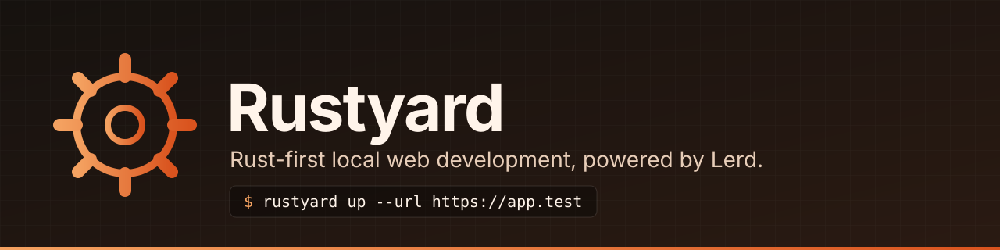

# Rustyard

<p align="center"></p>

A Rust-first local web development workflow for Linux, with a macOS path.
A runnable CLI project backed by Lerd; there is no standalone desktop interface yet.

The application runs natively on the host. The first backend is **Lerd >= 1.24**,
which supplies local domains, trusted HTTPS, app supervision, logs, a dashboard
and optional database/cache services. Rustyard supplies portable Rust project
configuration and a native source watcher. There is no PHP requirement in the
Rust app and no per-app container image.

## Requirements

- Linux with systemd (validated); macOS untested
- Rust 1.89+ and Cargo
- [Lerd](https://lerd.sh) >= 1.24, installed, running and healthy (host-proxy support)
- `curl` (used by `verify` and `up --url`, and checked by `doctor`)
- `journalctl` for `rustyard logs` on Linux
- For contributors only: `python3` for `scripts/smoke.py`

## Install and use

Do not run Rustyard as root. No system setup or tool downloads happen silently.

```bash
# From this repository; installs in ~/.local/bin.
./scripts/install.sh
rustyard doctor

# From an existing Rust WEB application:
cd ~/Projects/your-web-app
rustyard init
rustyard up
rustyard open
```

`~/.local/bin` must be on PATH. Lerd asks once before executing the configured
host command. `rustyard up --yes` explicitly approves it for scripting.
`rustyard up --dry-run` shows the adapter and commands without writing anything.
`init` creates only `.rustyard.toml`; no app is started until `up` or `dev`.

To activate the bundled example on your host in one step:

```bash
cd ~/Projects/rustyard
./scripts/activate.sh
```

This installs Rustyard in `~/.local/bin`, runs live infrastructure checks, links
only `examples/hello`, waits for trusted HTTPS at `https://hello-rust.test/health`,
checks its response and opens the browser. It stops on failure, with the original
error. Lerd must already be running (`lerd start` on the host if necessary).
It creates the example's app worker through Lerd. It does not change your DNS
setup, CA trust or other projects.
Pass your actual base URL if using another TLD: `./scripts/activate.sh https://hello-rust.local`.

To create a new website:

```bash
rustyard new ~/Projects/my-rust-site
rustyard -C ~/Projects/my-rust-site up --url https://my-rust-site.test/health
rustyard -C ~/Projects/my-rust-site open
```

`new` scaffolds Axum, a locked dependency set, HOST/PORT support, `/health`,
a gitignore, `.rustyard.toml` and an `AGENTS.md` requiring Rustyard for the local
web runtime. It never executes the new project or installs
services. The destination must not exist. Use `--port 3100` if automatic port
selection is unavailable.

Commands:

| Command | Behavior |
| --- | --- |
| `new <path> [--name app] [--port 3100]` | Create a configured Axum website without starting it |
| `init [--name app] [--port 3100] [-- cargo run --bin server]` | Configure an existing Rust web app; infer name and choose a free port when omitted |
| `up [--yes] [--dry-run] [--url https://site.test/health]` | Generate or validate the local adapter, link with HTTPS, and apply declared group/aliases |
| `dev` | Foreground app + source watcher, independent of Lerd |
| `start`, `stop`, `restart` | Resume, pause or restart the Lerd-managed app |
| `open` | Open the actual site domain through Lerd |
| `dashboard` | Open Lerd's dashboard, including Dev Server logs and services |
| `unlink` | Stop/unregister the site; retain project files |
| `sites` | List all registered Lerd sites |
| `logs [-f] [-n 100]` | Read the Linux Dev Server journal; open the Dev Server dashboard on macOS |
| `verify --url <url> [--contains text] [--timeout 120]` | Require HTTP 2xx and optional response text, with DNS and TLS verification |
| `doctor [--tools-only]` | Check installed tools, Lerd infrastructure and permission to bind local sockets; optionally tools only |

`up --url` waits for the exact URL after linking; without it, link completion
does not imply readiness. `verify` disables HTTP proxies and curl config, uses
normal certificate verification, and rejects redirects and non-2xx responses.
Use the actual domain printed by Lerd, including any custom TLD or port.
Compilation failure remains visible in logs; the watcher retries after another edit.

Use `-C /path/to/project` with any command instead of changing directories.
`start` resumes an already linked site; run `up` for initial registration.

## Try the Axum example

After installing Rustyard:

```bash
cd examples/hello
rustyard init --name hello-rust
rustyard up
rustyard open
```

The domain is normally `https://hello-rust.test`; Lerd's configured TLD wins.
Edit `src/main.rs` to trigger a rebuild/restart. `/health` returns `ok`.
Browser pages are not automatically refreshed yet.

For a loopback-only foreground test, without domains or Lerd:

```bash
rustyard dev
# Open http://127.0.0.1:<port from .rustyard.toml>
```

## Contract with your app

Rust web frameworks do not share a standard development command or bind setting.
Rustyard cannot infer these reliably. Your app must read **HOST** and **PORT**:

```rust
let host = std::env::var("HOST").unwrap_or_else(|_| "127.0.0.1".into());
let port = std::env::var("PORT").unwrap_or_else(|_| "3100".into());
let listener = tokio::net::TcpListener::bind(format!("{host}:{port}")).await?;
```

Direct `dev` defaults to loopback. Under Lerd, HOST is injected for reachability
from its proxy container. Depending on Linux networking, or on macOS, that can
be a LAN interface or `0.0.0.0`; the app is then reachable on that interface.
Keep the dev app free of production secrets and use your normal local firewall.

`command` is an argv array, never implicitly passed through a shell:

```toml
name = "my-app"
port = 3100
command = ["cargo", "run", "--bin", "server"]
watch = ["src", "templates", "static", "Cargo.toml", "Cargo.lock", "build.rs", ".env"]
```

This config can be committed. Workspaces or multi-binary projects should specify
the correct `cargo run -p ... --bin ...` command. Existing apps that hardcode a
bind address need adapting first. The source watcher polls content every 500 ms,
debounces edits and stops the full old process group before starting its replacement.
It watches additions/deletions and ignores symlinks, `target`, `.git` and
`node_modules`. For large asset trees, narrow `watch` to avoid unnecessary IO.
No `.env` loading is added: use your app's existing dotenv support.

Compilation errors remain visible in the terminal/Lerd Dev Server logs. The
watcher waits for another edit to retry. The old server is stopped during the
build, so a request can temporarily return a proxy error. A green Lerd process
indicator only confirms the watcher is running, not app readiness.

For a separate app under another Lerd site's hostname, declare the exact
subdomain as primary and any retained standalone name as an alias. Names omit
Lerd's local TLD so the config is portable:

```toml
name = "orders"
port = 3100
command = ["cargo", "run", "--locked", "--bin", "orders"]
watch = ["src", "Cargo.toml", "Cargo.lock", ".env"]
domains = ["orders.company", "orders"]

[group]
main = "company"
label = "orders"
```

Link the main site first, then run `rustyard up --yes` from the secondary.
Rustyard uses Lerd's site group for the exact subdomain route, without sharing
databases, and adds the standalone alias afterward. Repeated `up` retains the
grouped primary. Verify every required URL with `rustyard verify --url` and
check an app-specific response; a 2xx from the main site's wildcard is not
proof that the secondary answered. The grouped project's directory must match
its configured `name` so a later no-argument Lerd re-link preserves the primary.

## Local adapter ownership

`.lerd.yaml` is generated at `up` time and includes the absolute installed
Rustyard executable path. Keep it out of git using your project's `.gitignore`
or `.git/info/exclude`. Install Rustyard in a stable path before linking.
Lerd may normalize YAML formatting and add its managed domain list. Rustyard
accepts the equivalent, declared adapter without rewriting it; it rejects an
altered proxy command, port, TLS setting, foreign domain, or unsupported field.
It never edits `.env`, resolver settings or another project's config. If the
executable path/name/port changes, pause the site, review and move the old
adapter aside, then run `up` again. Ordinary changes to `command`/`watch` in
`.rustyard.toml` take effect after `restart`.

Project commands run with your user privileges; use trusted projects.
Rustyard does not park/auto-execute repositories just because a folder exists.
Services can be managed through the existing Lerd dashboard or `lerd service`.
Automatic migrations, `.env` rewriting and database creation are not included.

## Development and next steps

The automated suite covers real process restart and shutdown, scaffolding,
backend failure propagation, YAML normalization, grouped aliases and readiness
response semantics. Linux is the validated platform; macOS has not been
compiled or tested yet.

Run the checks (format, tests, Clippy with `-D warnings`, the example app) and,
on a host with a working Lerd installation, the smoke tests:

```bash
./scripts/check.sh
# On the host, after installation (uses a temporary isolated website):
python3 scripts/smoke.py --runner "$HOME/.local/bin/rustyard"
python3 scripts/smoke.py --runner "$HOME/.local/bin/rustyard" --https
```

The HTTP smoke test checks a real Axum response, source rebuild, recovery after
a deliberately failed compilation and clean shutdown. The HTTPS smoke test
checks real DNS/certificate trust, source rebuild, pause/resume and unlink.
HTTPS mode explicitly links one temporary site and removes it afterward.
Use `--tld <your-tld>` if needed. The HTTP log is saved to `target/smoke.log`;
HTTPS logs are available in Lerd's Dev Server tab during the test.

The installer takes an optional absolute prefix. For installation wholly inside
the repository (and no shell PATH changes):

```bash
./scripts/install.sh "$PWD/.local"
./.local/bin/rustyard --help
```

Set `CARGO_NET_OFFLINE=true` when all locked crates are already cached.

Implementation is separated into project configuration, a Lerd adapter, and a
native development process runner. Keep this a single Rust binary until there
is evidence that additional processes are useful.

Next milestones, in order:

1. App readiness checks, retained last-good executable on compilation failure,
   named-port collision handling and optional browser refresh.
2. Rust project discovery/park with explicit trust, setup wizard and
   service/environment recipes (Axum scaffolding is included).
3. macOS CI and a real Apple Silicon smoke test (Lerd uses a Podman VM there).
4. A Rust-focused dashboard/tray interface, then decide whether a standalone
   DNS/proxy backend is justified. Existing Lerd functionality is reused today.

No production deployment or Forge integration belongs in this development tool.

Reference: [Lerd host-proxy documentation](https://lerd.sh/usage/host-proxy).
